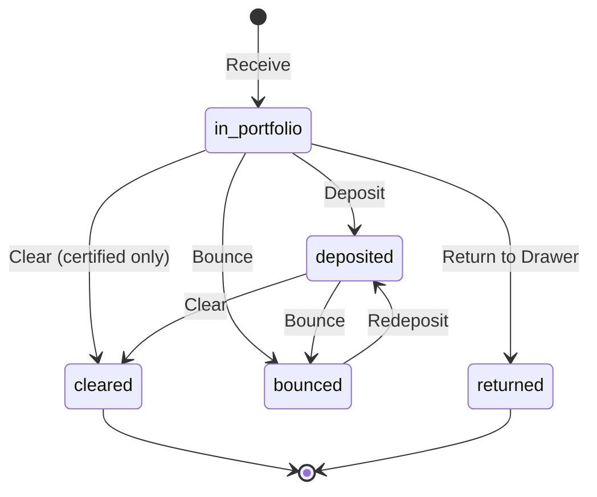
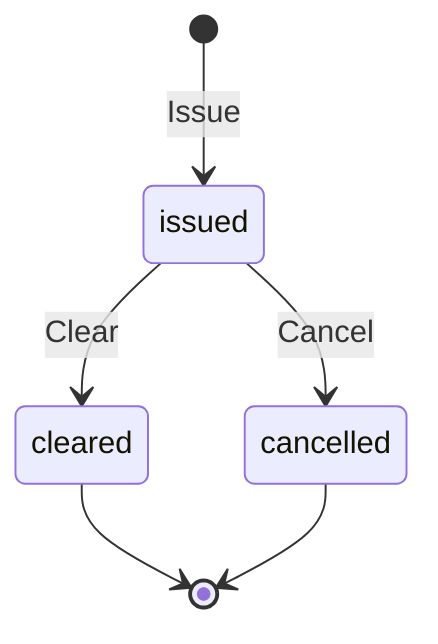

# Phase 08: Full Accounting, Overhead & Fixed Assets

> **Duration Estimate:** 5–6 weeks  
> **Team Size:** 2 backend engineers, 1 frontend engineer (shared with Phase 09)  
> **Dependencies:** Phase 01 (Foundation), Phase 02–07 (all operational modules)

---

## 8.1 Objective

Build the complete double-entry accounting ledger that automatically posts balanced journal entries for every business event defined in the cross-module integration list (Section 17 of SRS). Includes chart of accounts, journal entries with polymorphic source document linking, per-unit subledgers, landed cost allocation, FX gain/loss, overhead expense tracking and allocation, fixed asset register, and depreciation processing.

### Architecture & API Scope
All double-entry journal postings, subledger reconciliations, trial balance reports, overhead allocations, and fixed asset depreciation execute live via direct central REST API endpoints against the central server database.

---

## 8.2 Deliverables

| # | Deliverable | Acceptance Criteria |
|---|-------------|---------------------|
| 1 | Chart of Accounts | Hierarchical CoA with account codes, types (asset/liability/equity/revenue/expense), multi-currency support |
| 2 | Auto journal posting engine | Every event from Section 17 auto-creates balanced JournalEntry via observers/services |
| 3 | Journal entry management | View, filter, search by source document, date, account; manual adjustment capability for corrections |
| 4 | Subledger reporting | Per-unit period rollups derived from JournalLine.unit_id |
| 5 | Landed cost allocation | ImportOrder.Complete allocates all LandedCostLines into raw-material inventory value |
| 6 | FX gain/loss posting | Auto-calculated and posted when realized rate differs from booked estimate |
| 7 | Overhead expense tracking | Water, electricity, rent, maintenance entry per unit or company-wide |
| 8 | Overhead allocation rules | Configurable methods: even_split, usage_based, headcount_based, manual_percentage |
| 9 | Full-absorption costing toggle | Company-level `overhead_absorption_enabled` flag affecting inventory valuation |
| 10 | Fixed asset register | Acquisition, depreciation method, useful life, salvage value tracking |
| 11 | Depreciation processing | Monthly straight-line or declining-balance; auto-posts journal entries |
| 12 | Asset disposal | Gain/loss calculation against remaining book value |
| 13 | Unit client: Accounting screens | Journal entry viewer, CoA tree, subledger reports, trial balance |
| 14 | Owner dashboard: Financial KPIs | Revenue, COGS, gross margin, net profit, unit profitability |

---

## 8.3 Database Migrations (This Phase)

- `chart_of_accounts`
- `accounts`
- `journal_entries`
- `journal_lines`
- `subledgers`
- `overhead_expenses`
- `overhead_allocation_rules`
- `overhead_allocations`
- `fixed_assets`
- `depreciation_entries`

---

## 8.4 Journal Entry Templates by Event

### Event: ImportOrder.Complete
```
DR  Raw Material Inventory (at landed cost per unit)
CR  Accounts Payable — Supplier
CR  FX Gain/Loss Clearing (if applicable)

// Landed cost allocation:
DR  Raw Material Inventory
CR  Landed Cost Clearing (customs)
CR  Landed Cost Clearing (freight)
CR  Landed Cost Clearing (local transport)
```

### Event: ProductionBatch.Closed (Foam)
```
DR  Finished Goods Inventory — Foam Blocks
CR  Work In Process — Foam Production

// If labor cost included:
DR  Finished Goods Inventory — Foam Blocks
CR  Wages Payable / Labor Cost Clearing
```

### Event: CutterWorkOrder.Completed
```
DR  Finished Goods Inventory — Cut Pieces
DR  Finished Goods Inventory — Slices
DR  Finished Goods Inventory — Byproduct Fill
CR  Work In Process — Cutter Production
CR  Raw Materials Inventory — Foam Blocks
```

### Event: FurnitureProductionOrder.ReadyForCollection
```
DR  Finished Goods Inventory — Furniture
CR  Work In Process — Furniture Production
CR  Wages Payable / Labor Cost Clearing
```

### Event: SalesOrder.Fulfilled (External)
```
DR  Accounts Receivable — Client
CR  Sales Revenue

// COGS:
DR  Cost of Goods Sold
CR  Finished Goods Inventory — [Selling Unit]
```

### Event: SalesOrder.Fulfilled (Internal)
```
// At cost (v1 default):
DR  Inventory — Buyer Unit
CR  Inventory — Seller Unit

// At transfer price (future):
DR  Inventory — Buyer Unit (at transfer price)
CR  Inventory — Seller Unit (at cost)
CR  Inter-Unit Profit (difference)
```

### Event: POSSale.Completed
```
DR  Cash / Card Receivable
CR  Sales Revenue — POS

// COGS:
DR  Cost of Goods Sold
CR  Finished Goods Inventory — Store
```

### Event: PaymentRequest.Paid
```
// If realized rate differs from booked:
DR  FX Loss (if realized > booked)
CR  FX Gain (if realized < booked)
CR  Accounts Payable
```

### Event: PayrollRun.Posted
Payroll posts as two separate entries (HR-08, phase-08 §8.4):

1. **Accrual Entry** — dated `min(last day of period month, today)` (the period month end):
```
DR  57      Wage Expense — [Unit]               (gross pay)
CR  226     Wages Payable                       (net pay payable)
CR  225     Payroll Deductions Payable          (withheld)
```

2. **Payment Entry** — dated today (tripoli local date, posted only when total net > 0):
```
DR  226     Wages Payable                       (net pay)
CR  1211xx  Treasury / Cash Account             (net pay disbursed)
```

> **Note on Business Event Posting Dates (ACC-11):**
> Depreciation, overhead, and fixed-asset entries are dated on their business date (depreciation on `min(last day of period, today)`; overhead on `expense_date`; fixed-asset acquisition on `acquisition_date` and disposal on `disposed_at`). If an event is dated into a locked period, `PeriodGuard` throws `LedgerRuleException` (`PERIOD_LOCKED`), refusing the posting (ACC-11).

### Event: DepreciationEntry (Monthly)
```
DR  Depreciation Expense — [Unit]
CR  Accumulated Depreciation — [Asset]
```

### Event: Asset Disposal
```
DR  Cash (proceeds)
DR  Accumulated Depreciation (total)
DR  Loss on Disposal (if proceeds < book value)
CR  Fixed Asset (original cost)
CR  Gain on Disposal (if proceeds > book value)
```

---

## 8.5 Overhead Allocation

### OverheadExpense Entry
```
// Company-wide overhead (e.g., HQ rent):
DR  Overhead Expense — Allocated
CR  Cash / Payable

// Unit-specific overhead (e.g., Foam unit electricity):
DR  Overhead Expense — Foam Unit
CR  Cash / Payable
```

### Allocation Rules

| Method | Description |
|--------|-------------|
| `even_split` | Divide equally across all active units |
| `usage_based` | Divide by measured usage (e.g., kWh for electricity) |
| `headcount_based` | Divide by employee count per unit |
| `manual_percentage` | Explicit percentage per unit |

### Allocation Posting
```
// If overhead_absorption_enabled = true:
DR  Work In Process — [Unit]
CR  Overhead Expense — Allocated

// If overhead_absorption_enabled = false:
// Overhead stays as period expense; no WIP absorption
```

---

## 8.6 Depreciation Calculation

### Straight-Line
```
annual_depreciation = (acquisition_cost - salvage_value) / useful_life_years
monthly_depreciation = annual_depreciation / 12
```

### Declining Balance
```
rate = 2 / useful_life_years  // double-declining
annual_depreciation = book_value_at_start × rate
monthly_depreciation = annual_depreciation / 12
```

### Asset State Machine
```
Active ──[Monthly depreciation run]──► Active
  • Creates DepreciationEntry
  • Posts Depreciation Expense / Accumulated Depreciation JE

Active ──[Repair needed]──► UnderMaintenance
  • Optional: pause depreciation (configurable per company policy)

UnderMaintenance ──[Repair complete]──► Active

Active ──[Sold/scrapped]──► Disposed
  • Posts disposal journal entry
  • Gain/loss = proceeds - remaining_book_value
```

---

## 8.7 API Endpoints (This Phase)

### Chart of Accounts
```
GET    /api/v1/chart-of-accounts
POST   /api/v1/chart-of-accounts
GET    /api/v1/accounts
POST   /api/v1/accounts
GET    /api/v1/accounts/{id}
PUT    /api/v1/accounts/{id}
GET    /api/v1/accounts/{id}/ledger
```

### Journal Entries
```
GET    /api/v1/journal-entries
POST   /api/v1/journal-entries                        ← manual entries only
GET    /api/v1/journal-entries/{id}
GET    /api/v1/journal-entries/for-document/{type}/{id}
GET    /api/v1/journal-entries/unposted
POST   /api/v1/journal-entries/{id}/post
```

### Subledgers & Reports
```
GET    /api/v1/subledgers
GET    /api/v1/reports/trial-balance
GET    /api/v1/reports/income-statement
GET    /api/v1/reports/balance-sheet
GET    /api/v1/reports/unit-profitability
```

### Overhead
```
GET    /api/v1/overhead-expenses
POST   /api/v1/overhead-expenses
POST   /api/v1/overhead-expenses/{id}/allocate
```

### Fixed Assets
```
GET    /api/v1/fixed-assets
POST   /api/v1/fixed-assets
GET    /api/v1/fixed-assets/{id}
PUT    /api/v1/fixed-assets/{id}
POST   /api/v1/fixed-assets/{id}/depreciate            ← manual run
POST   /api/v1/fixed-assets/{id}/dispose
GET    /api/v1/fixed-assets/{id}/depreciation-schedule
```

---

## 8.8 Key Business Rules

| Rule ID | Description | Enforcement |
|---------|-------------|-------------|
| ACC-01 | Every journal entry must balance (sum debits = sum credits) | Validation before save; reject if unbalanced |
| ACC-02 | Every financially impactful event auto-posts a journal entry | Event observers in each operational module call `AccountingService::postJournal()` |
| ACC-03 | Journal entries link to source document via polymorphic relation | `source_document_type` + `source_document_id` required on auto-posted entries |
| ACC-04 | Manual journal entries allowed for corrections only | Policy: only Accounting Manager+ can create manual entries |
| ACC-05 | Subledger rollups are read-only derived views | Computed from journal_lines; not directly editable |
| ACC-06 | Overhead allocation respects company-level `overhead_absorption_enabled` flag | Service checks flag before posting WIP absorption |
| ACC-07 | Depreciation runs monthly via scheduled job | Laravel Scheduler command; can also be triggered manually |
| ACC-08 | Asset disposal calculates gain/loss correctly | Service method: `proceeds - (acquisition_cost - accumulated_depreciation)` |
| ACC-09 | FX gain/loss posted to dedicated account | CoA account code for FX Gain/Loss required |
| ACC-10 | Landed cost allocated on ImportOrder.Complete, not on receipt | Observer triggers only on Complete transition |
| ACC-11 | Nothing posts into a locked month or a closed fiscal year (Wave 1, 2026-10-20) | `PeriodGuard` inside `postJournal`; `PERIOD_LOCKED` / `YEAR_CLOSED`. Only an ended month can be locked; only the owner reopens, with a reason |
| ACC-12 | Year-end close moves every revenue/expense balance into 33 أرباح وخسائر مرحلة, one line per operating unit | `FiscalYearService::close`; reopening the year reverses the closing entry |
| ACC-13 | Posted entries never change; a correction is one linked reversal per entry | `LEDGER_IMMUTABLE`; `reversal_of_id` unique; closing entries and reversals are not reversible directly |
| ACC-14 | A frozen account (or one under a frozen parent) refuses postings | `ACCOUNT_FROZEN`; reversal and closing mirrors are exempt |
| ACC-15 | A foreign line's LYD amount equals original amount × rate | `FX_AMOUNT_MISMATCH` beyond 0.01; books stay in LYD |
| ACC-16 | Reports and balances count only lines of non-deleted entries | `JournalLine::scopePosted()` |

Under ACC-15, journal lines track `currency`, `original_amount`, and `fx_rate` (derived as `round(lyd / original, 8)` if omitted; checked against LYD with 0.01 tolerance). Import payments stamp foreign currency on the supplier advance line and any matching-currency FX safe credit line. Historical supplier advance lines can be stamped via `php artisan ledger:backfill-line-currency {--dry-run}`.

Cost centers were decided out on 2026-10-20: operating units on `journal_lines.operating_unit_id` serve that purpose.

### 8.8.1 Fiscal Year-End Close, Year Reopen, and Report Alignment (ACC-12)

- **Closing Entry & 33-Per-Unit Rule:**
  - A closing entry (`entry_type = Closing`, dated the fiscal year `end_date`) zeroes out all revenue and expense account balances of the year (`[start_date, end_date]`, excluding closing-related entries).
  - Every operating unit with net income/loss receives exactly one balancing line on `33` (أرباح وخسائر مرحلة). Unallocated lines (null operating unit) form their own group. Net profit credits `33`; net loss debits `33`.
  - A fiscal year with no P&L activity closes without an entry (`closing_entry_id = null`).
  - Account `401` (بضاعة أول المدة) is classified as an asset under `13` (inventory), ensuring it carries forward without being zeroed into `33`.
- **Preview & Refusal Codes:**
  - `FiscalYearService::preview()` returns generated closing lines, unit summaries, net income, and a list of `blockers`.
  - `FiscalYearService::close()` strictly enforces refusal codes in this sequence:
    1. `YEAR_ALREADY_CLOSED`: Year status is already closed.
    2. `YEAR_NOT_ENDED`: Company clock (`CompanyClock::today()`) is not after `end_date`.
    3. `PREVIOUS_YEAR_OPEN`: An earlier fiscal year of the company is still open.
    4. `YEAR_PERIODS_NOT_LOCKED`: One or more months of the year remain open (`open_periods` context array).
    5. `RETAINED_EARNINGS_NOT_POSTABLE`: Account `33` is missing, frozen, or has sub-accounts.
- **Reopening a Closed Year:**
  - Only the owner may reopen a closed year (`POST /fiscal-years/{id}/reopen` with audit `reason`).
  - Refuses with `YEAR_NOT_CLOSED` if the year is not closed, or `LATER_YEAR_CLOSED` if any subsequent fiscal year is closed.
  - Automatically reverses the closing entry (if any) via `AccountingService::reverseClosingEntry` (`entry_type = Reversal`, `reversal_of_id` linked).
  - Year status returns to Open; months stay locked. Direct user reversals via `/journal-entries/{id}/reverse` remain refused with `CLOSING_NOT_REVERSIBLE`.
- **Financial Report Alignment:**
  - **Income Statement & Unit Profitability:** Filter out closing-related entries (`scopeClosingRelated()`), preserving historical operating revenue, expenses, and net profit visibility.
  - **Balance Sheet:** Integrates closing entries on balance-sheet and equity accounts (`33`), and includes unclosed period earnings (`Σ(credit - debit)` of P&L lines including closing entries) under `retained_current_period` (`retained_current_period_label` => 'أرباح الفترات غير المقفلة'). Equity and assets/liabilities balance across any historical or current `as_of` date.

### 8.8.2 Treasury Rules (Wave 2)

| Rule ID | Summary | Detail / Enforcement |
|---|---|---|
| TRS-01 | Treasury balance = ledger balance of its linked account | The stored `CashAccount.balance` column is only the creation-time opening figure; the live balance is the ledger balance of its linked account (`JournalLine::scopePosted()`). |
| TRS-02 | A voucher posts once; cancelling reverses it | Receipt and payment vouchers post balanced journal entries once; cancellation creates a linked reversal entry. |
| TRS-03 | A transfer posts only after approval by someone other than its creator (owner excepted), same currency only | Internal treasury transfers require dual-control approval unless initiated by the owner; source and destination must share the same currency. |
| TRS-04 | A reconciliation finishes only at zero difference; a ledger line is cleared at most once | Treasury reconciliation finishes only at zero unreconciled difference; a posted ledger line is cleared at most once. |
| TRS-05 | A cheque moves only along its allowed states, one entry per move | A cheque moves strictly through its permitted lifecycle states, creating one balanced journal entry per move. |
| TRS-06 | The POS daily close posts its cash difference to 625 (shortage) / 44 (surplus) | Daily POS till closing posts cash discrepancy to 625 (عجز الخزائن) for shortages, or 44 (زيادة الخزائن) for surpluses. |

Transfer flow: Draft -> Approved | Rejected | Cancelled. Approval posts DR to-treasury / CR from-treasury on live balance check; draft, rejection, and cancellation post nothing.
Reconciliation flow: Draft -> Finished. Clears candidate posted lines on a bank treasury up to statement date; finishes strictly at zero difference (|diff| < 0.005) with opening balance chaining from the prior finished statement.

Incoming Cheque flow (TRS-05): InPortfolio -> Deposited | Cleared (certified only) | Bounced | ReturnedToDrawer; Deposited -> Cleared | Bounced; Bounced -> Deposited (redeposit); Cleared and ReturnedToDrawer terminal.



| Lifecycle Move | Permitted From | Target Status | Journal Entry (DR / CR) | Client Balance Movement |
|---|---|---|---|---|
| Receive | New | `in_portfolio` | DR 124 (Notes Receivable) / CR Client Receivable | Balance decreases (credit) |
| Deposit | `in_portfolio` | `deposited` | DR 125 (Cheques Under Collection) / CR 124 (Notes Receivable) | Unchanged |
| Redeposit | `bounced` | `deposited` | DR 125 (Cheques Under Collection) / CR Client Receivable | Balance decreases (credit) |
| Clear | `deposited` | `cleared` | DR Bank Treasury / CR 125 (Cheques Under Collection) | Unchanged |
| Clear Certified | `in_portfolio` (certified only) | `cleared` | DR Bank Treasury / CR 124 (Notes Receivable) | Unchanged |
| Bounce | `deposited` | `bounced` | DR Client Receivable / CR 125 (Cheques Under Collection) | Balance increases (debit) |
| Bounce | `in_portfolio` | `bounced` | DR Client Receivable / CR 124 (Notes Receivable) | Balance increases (debit) |
| Return to Drawer | `in_portfolio` | `returned` | DR Client Receivable / CR 124 (Notes Receivable) | Balance increases (debit) |

Outgoing Cheque flow (TRS-05): Issued -> Cleared | Cancelled; Cleared and Cancelled terminal.



| Lifecycle Move | Permitted From | Target Status | Journal Entry (DR / CR) | Balance / Offset Movement |
|---|---|---|---|---|
| Issue (Supplier) | New | `issued` | DR Supplier Account (221) / CR 227 (Notes Payable) | Supplier liability reduced |
| Issue (Counter Account) | New | `issued` | DR Counter Account / CR 227 (Notes Payable) | Expense or liability debited |
| Clear | `issued` | `cleared` | DR 227 (Notes Payable) / CR Bank Treasury | Bank ledger balance drops |
| Cancel | `issued` | `cancelled` | Mirror Reversal of Issue Entry (DR 227 / CR Counter Account) | Issue entry reversed |

#### New Treasury Accounts (Wave 2)
- **125 (شيكات برسم التحصيل - Cheques under Collection):** Asset under `12` (الأصول المتداولة) for holding received customer cheques awaiting bank deposit or clearance.
- **227 (أوراق الدفع - Notes Payable):** Liability under `22` (المطاليب والالتزامات المتداولة) for promissory notes and commercial paper payable to creditors or suppliers.
- **44 (زيادة الخزائن - Cash Overage):** Revenue under `4` (الإيرادات) for recording treasury and POS cash surpluses upon reconciliation or daily close.
- **625 (عجز الخزائن - Cash Shortage):** Expense under `6` (المصاريف التشغيلية والإدارية) for recording treasury and POS cash deficits upon reconciliation or daily close.

#### POS Daily Close Difference Posting (TRS-06)
The POS daily close reconciles physically counted cash with expected cash derived from today's cash sales and cash collections. When the discrepancy is material (|counted − expected| ≥ 0.005), an automatic journal entry is posted dated the close date (`sourceType: 'PosDailyClose'`, tagged with the operating unit):
- Shortage (counted < expected): DR 625 (عجز الخزائن) / CR Drawer Treasury.
- Surplus (counted > expected): DR Drawer Treasury / CR 44 (زيادة الخزائن).

**Treasury Selection Rule:**
- Expected cash is calculated as the sum of today's cash payments for the operating unit into the drawer treasury (`cash_account_id`).
- When `cash_account_id` is omitted: if exactly one cash treasury received payments today, it is auto-selected; if multiple treasuries received payments, `cash_account_id` is required (refusal 422 `CASH_ACCOUNT_REQUIRED` with context listing candidate treasuries); if none received payments and counted is 0, the day closes without posting; if none received payments and counted > 0, `cash_account_id` is required.
- The close and its journal entry commit in the same transaction. If posting fails (e.g., locked accounting month), the transaction is rolled back and no close record is written.

**Cheque Collections on Receivable Sales:**
Collecting a receivable sale by cheque receives the customer cheque into portfolio via `ChequeService::receive` (DR 124 / CR Client Receivable, reducing client balance once) without a duplicate collection journal, links `SalePayment.cheque_id`, and excludes cheque payments from expected cash calculations.

---

## 8.9 Testing Strategy

- **Unit tests:** Depreciation formulas, overhead allocation calculations, gain/loss on disposal
- **Feature tests:** Each event from Section 17 produces correct journal entry; trial balance balances
- **Integration tests:** End-to-end: ImportOrder → LandedCost → JournalEntry → Trial Balance

---

## 8.10 Risks & Mitigations

| Risk | Impact | Mitigation |
|------|--------|------------|
| Journal entries become unbalanced due to rounding | Medium | Store amounts with 4 decimal precision; validation check with small tolerance |
| Auto-posting creates incorrect entries | High | Extensive unit tests per event type; manual review dashboard for Accounting Manager |
| Depreciation scheduled job fails silently | Medium | Log every run; alert on failure; idempotent re-runs |
| Subledger performance degrades | Low | Materialized view or caching; subledgers refreshed nightly, not real-time |

---

## 8.11 Open Questions to Resolve

1. **Full-absorption costing:** Does the business want overhead loaded into inventory/COGS, or period-expense-only? (SRS 19.4) — *Default: period-expense-only for v1; schema supports toggle.*
2. **Internal transfer pricing:** At-cost or transfer price? (SRS Section 18) — *Default: at-cost for v1.*

---

## 8.12 Phase Exit Criteria

- [ ] Every business event from Section 17 produces a balanced journal entry
- [ ] Trial balance is always in balance
- [ ] Chart of Accounts supports hierarchical structure and multi-currency
- [ ] Subledger reports show accurate per-unit financials
- [ ] Overhead expenses allocate correctly per configured rules
- [ ] Depreciation entries calculate and post correctly monthly
- [ ] Asset disposal calculates gain/loss accurately
- [ ] Owner dashboard shows financial KPIs (revenue, COGS, margins)
- [ ] Unit client accounting screens functional in Arabic/RTL
